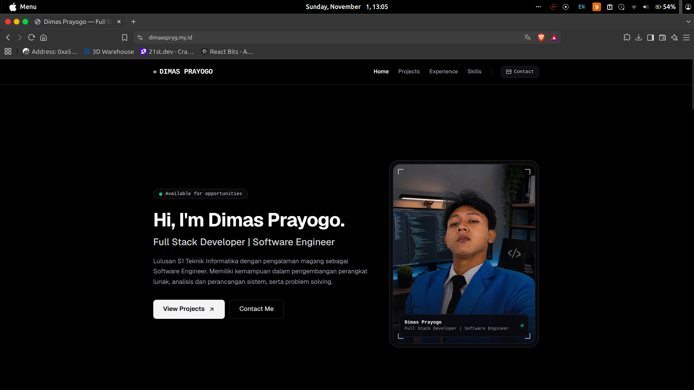
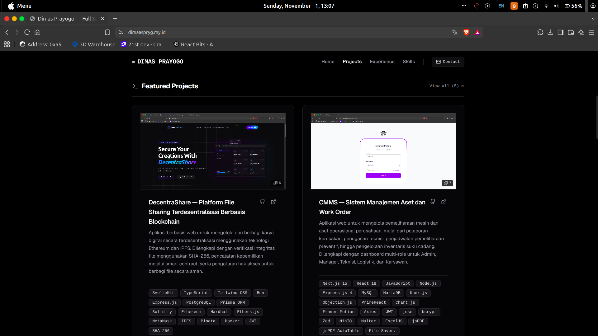
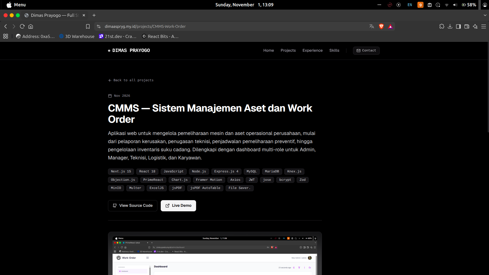
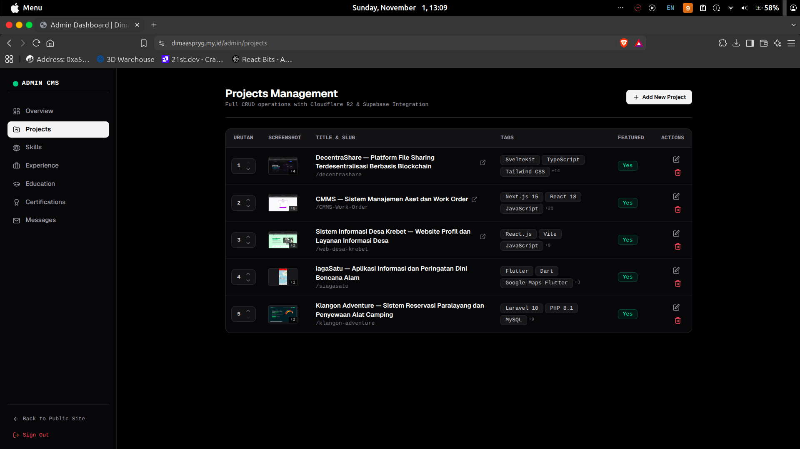

# Dimas Prayogo — Personal Portfolio & CMS

[](https://nextjs.org/)
[](https://react.dev/)
[](https://www.typescriptlang.org/)
[](https://tailwindcss.com/)
[](https://supabase.com/)
[](https://developers.cloudflare.com/r2/)
[](https://bun.sh/)

Website portofolio interaktif dan modern dilengkapi Content Management System (CMS) terintegrasi untuk mengelola proyek, riwayat kerja, keahlian, sertifikasi, serta pesan masuk secara dinamis.

---

## 📸 Preview UI

| Hero Section | Landing Project Preview |
| :---: | :---: |
| [](./public/screenshots/hero.png) | [](./public/screenshots/projects.png) |
| *Hero section dan profil* | *Showcase daftar proyek pada landing page* |

| Detail Project Preview | Manajemen Project CRUD (Admin) |
| :---: | :---: |
| [](./public/screenshots/detail-project.png) | [](./public/screenshots/crud-project.png) |
| *Tampilan rincian proyek dan galeri* | *Tabel proyek dan form CRUD admin* |

---

## ⚡ Fitur Utama

### 🌐 Sisi Publik
- **Hero & Profil Interaktif**: Animasi teks split-flap dan decrypted text interaktif menggunakan Motion.
- **Showcase Proyek**: Filter proyek unggulan, halaman index proyek, serta halaman rincian berbasis slug (`/projects/[slug]`).
- **Riwayat Pengalaman & Pendidikan**: Timeline pekerjaan, detail pencapaian, dan riwayat akademik.
- **Keahlian & Sertifikasi**: Katalog kompetensi teknis per kategori dengan efek interaktif glowing borders.
- **Form Kontak**: Pengiriman pesan langsung yang tersimpan ke database.

### 🛠️ Sisi Admin (CMS)
- **Otentikasi Aman**: Login berbasis sesi menggunakan Supabase SSR & Middleware guard.
- **Dashboard Metrik**: Ringkasan jumlah proyek, keahlian terdaftar, riwayat kerja, dan pesan masuk.
- **CRUD Manajemen Konten**:
  - Manajemen Proyek (Multi-image upload, deskripsi, tech stack tags, URL demo/repo).
  - Manajemen Riwayat Kerja & Pendidikan.
  - Manajemen Sertifikasi & Kredensial.
  - Manajemen Keahlian (Skills) per kategori.
- **Kotak Masuk Pesan**: Tinjauan pesan formulir kontak dari pengunjung.
- **Storage Terintegrasi**: Upload aset media langsung ke Cloudflare R2 Object Storage melalui S3 SDK.

---

## 🛠️ Tech Stack

- **Framework**: [Next.js 16](https://nextjs.org/) (App Router, Server Actions)
- **Library UI & Animasi**: [React 19](https://react.dev/), [Tailwind CSS v4](https://tailwindcss.com/), [Motion](https://motion.dev/), [Lucide React](https://lucide.dev/)
- **Database & Auth**: [Supabase](https://supabase.com/) (`@supabase/supabase-js`, `@supabase/ssr`)
- **Penyimpanan Aset**: [Cloudflare R2](https://developers.cloudflare.com/r2/) via `@aws-sdk/client-s3`
- **Language & Runtime**: [TypeScript](https://www.typescriptlang.org/), [Bun](https://bun.sh/) / Node.js

---

## 📁 Struktur Direktori

```text
├── src/
│   ├── app/
│   │   ├── (public)/          # Rute halaman publik (Home, Projects, Contact)
│   │   ├── actions/           # Next.js Server Actions (upload, CRUD)
│   │   ├── admin/             # Panel CMS internal (Dashboard, CRUD modules)
│   │   ├── api/               # Rute API internal (proxy aset R2)
│   │   ├── auth/              # Halaman autentikasi admin (Login)
│   │   └── globals.css        # Konfigurasi Tailwind CSS v4 & styling global
│   ├── components/            # Komponen modular (UI primitives, Layout, Icons)
│   ├── constants/             # Konfigurasi profil & navigasi statis
│   ├── features/              # Logika data, mock, dan layanan per fitur
│   ├── lib/                   # Utilitas Supabase client/server/storage & S3 client
│   └── types/                 # Definisi type data TypeScript
├── public/                    # Aset statis publik
├── .env.example               # Template environment variables
└── package.json
```

---

## 🚀 Memulai (Local Development)

### 1. Prasyarat
- [Bun](https://bun.sh/) (disarankan) atau Node.js 20+
- Akun dan project [Supabase](https://supabase.com/)
- Akun [Cloudflare R2](https://developers.cloudflare.com/r2/) (bucket & API tokens)

### 2. Kloning Repositori
```bash
git clone https://github.com/dimasprayogox/dimasprayogo-portofolio.git
cd dimasprayogo-portofolio
```

### 3. Instal Dependensi
```bash
bun install
# atau
npm install
```

### 4. Konfigurasi Environment Variables
Salin file konfigurasi contoh:
```bash
cp .env.example .env.local
```

Isi variabel pada `.env.local`:
```env
# SUPABASE DATABASE & AUTH CONFIGURATION
NEXT_PUBLIC_SUPABASE_URL=https://<project-ref>.supabase.co
NEXT_PUBLIC_SUPABASE_ANON_KEY=your_supabase_anon_key
SUPABASE_SERVICE_ROLE_KEY=your_supabase_service_role_key

# CLOUDFLARE R2 OBJECT STORAGE CONFIGURATION
R2_ACCOUNT_ID=your_cloudflare_account_id
R2_ACCESS_KEY_ID=your_r2_access_key_id
R2_SECRET_ACCESS_KEY=your_r2_secret_access_key
R2_BUCKET_NAME=your_r2_bucket_name
R2_PUBLIC_DOMAIN=https://pub-<hash>.r2.dev
```

### 5. Jalankan Server Pengembangan
```bash
bun run dev
# atau
npm run dev
```

Buka [http://localhost:3000](http://localhost:3000) pada browser.

---

## 📜 Skrip Tersedia

| Perintah | Deskripsi |
| :--- | :--- |
| `bun run dev` | Menjalankan Next.js development server dengan Webpack |
| `bun run build` | Membuat production build aplikasi |
| `bun run start` | Menjalankan server hasil production build |
| `bun run lint` | Menjalankan pengecekan ESLint |

---

## 👤 Profil & Kontak

- **Nama**: Dimas Prayogo
- **Website**: [dimaaspryg.my.id](https://dimaaspryg.my.id)
- **GitHub**: [@dimasprayogox](https://github.com/dimasprayogox)
- **LinkedIn**: [dimas-prayogo1](https://linkedin.com/in/dimas-prayogo1)
- **Email**: [dimasprayogo9c@gmail.com](mailto:dimasprayogo9c@gmail.com)
